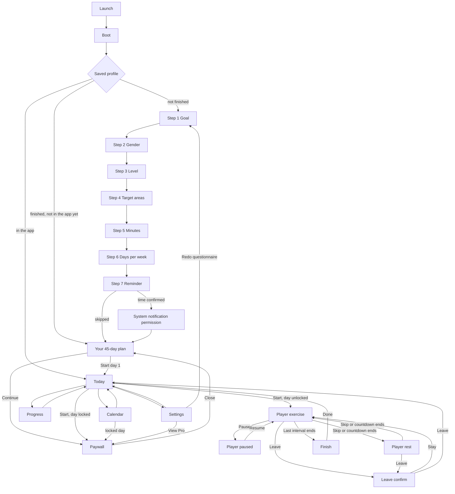

# Redesign plan — 45 Days Abs Challenge

Status: proposal for approval. This branch contains only this note and `docs/ux-research.md`. No UI or app code.

The research behind the patterns is in [docs/ux-research.md](ux-research.md). This file is the spec those findings turn into: the questions, the screens, the navigation, the storage, the rule that builds the 45 days, and what must not change.

Words the shipped UI must not use: a medical claim, a weight-loss guarantee, or any claim that the plan is AI. On the first questionnaire step, the plan summary, and Settings, include this line: “Consult a doctor before starting any exercise program.” Also tell people to stop if they feel pain.

## (a) Onboarding questionnaire

Seven steps. One question per screen. A progress label reads “Step n of 7”. Each option is a large card (at least 44 points tall). Back is on steps 2–7 and returns without discarding earlier answers. Skip is on every step: it writes that step’s default and moves forward. Next stays disabled until the step has a valid answer (for target areas, at least one). The draft is saved after every Next or Skip.

Gender does not change the exercises, the rounds, or the rest. Height, weight, BMI, body shape, diet, and a target weight are not questions.

| Step | Question | Options | Why it is asked | Skip default |
| --- | --- | --- | --- | --- |
| 1 | What do you want from this plan? | Stronger core. A daily habit. Steadier control. Feel more capable. | Names the plan and adjusts rest by a few seconds. It does not promise a look. | A daily habit |
| 2 | How should we label the plan? | Woman. Man. Prefer not to say. | Same question other fitness quizzes ask, saved on this device as a label only. The subtitle says it does not change the exercises. | Prefer not to say |
| 3 | Where are you starting? | Starting out — new to core training. Building — you train sometimes. Experienced — core work is already familiar. | Sets the level name, the base round count, and the base rest. This replaces any body-stat or BMI calculation. | Building |
| 4 | Which areas should come first? | Upper abs. Lower abs. Obliques. Whole core. Multi-select. | Reorders moves so the chosen areas are earlier in the session, then trims the list to the time budget. It does not change rounds or rest. | Whole core |
| 5 | How many minutes on a training day? | 8. 12. 18. 25. | Sets how many moves are kept, and nudges the round count at the short and long ends. | 12 |
| 6 | How many days a week? | 3, 4, 5, or 6. Each card shows which days in a 7-day block are training days. | Decides the rest days. The seventh day of every block is always rest. | 4 |
| 7 | When should we remind you? | 7:00 AM. 12:30 PM. 6:00 PM. 8:30 PM. | Stores a clock time for a local daily notification. Next on this step is the only onboarding moment that asks for notification permission. | Skip leaves the reminder off and does not ask for permission. |

Step 1 also shows the doctor line. There is no eighth “building your plan” animation that pretends to think. The next screen is the summary, and it shows the numbers the rule produced.

### Plan summary (after step 7, before the tabs)

Purpose: show the plan the answers produced, then offer Pro without blocking day 1.

Contents:

- Title: “Your 45-day plan”.
- Level name, rounds, rest seconds, training-day minutes, days per week, focus areas, and the reminder time or “No reminder”.
- One sentence: the numbers come from a fixed rule, not a prediction.
- The four calendar phases (Foundation, Build, Intensify, Peak) and the day ranges, so progression is visible before the first session.
- The doctor line.
- Primary button “Continue” opens the existing paywall.
- Secondary button “Start day 1” enters Today without a purchase.
- Closing the paywall returns here. “Start day 1” is what marks onboarding finished.

## (b) Main screens

Five primary screens. Four are tabs: Today, Calendar, Progress, Settings. The player is the fifth. It covers the tabs until the session ends or the person leaves. Finish is the player’s last state, not its own tab.

### 1. Today

Purpose: show the one session that can be started, and the plan streak.

Contents:

- Plan streak (see storage). “Day n of 45”. The calendar phase for that day.
- A session card: training or rest, title, minutes, rounds, rest, and the move names.
- One Start button when this calendar day is free or Pro is active.
- A Pro control in the header when the person is not Pro.

Edge states:

- New plan: streak 0, day 1, Start available. Day 1 is a training day for every days-per-week option.
- Rest day: the card is titled “Easy mobility”, and Start still works. Completing it counts as that day.
- Locked day (8–45 without Pro): the day title is visible, the move list is not, and the button is “Unlock Pro”. It opens the paywall. Start does not run.
- Day 45 already completed: “Plan complete”. No Start. The streak and the calendar remain.

### 2. Calendar

Purpose: show all 45 days, what is done, what is now, and what is locked.

Contents: a 7-column grid, six full weeks plus three days. Cell states, which can combine:

- Completed: filled, with a check.
- Current: the next day to do, outlined.
- Locked: days 8–45 without Pro, dimmed, with a lock mark.
- Rest: the days the weekly pattern marks as rest.
- Milestone: days 7, 14, 21, 28, 35, and 42, which are always rest, labeled as the end of a week.

Empty state: nothing completed, day 1 current, days 8–45 locked for a free user. That is the first open of the calendar, not a separate screen.

Tap a day to open a preview sheet: phase, title, training or rest, rounds, rest, and move names if the day is unlocked. Start is on that sheet only when the day is the current day and it is unlocked. A completed day is read-only. A future unlocked day says it opens when the plan reaches it. A locked day opens the paywall instead of the move list.

### 3. Player

Purpose: run today’s session one move at a time.

Contents and states:

- Exercise. Move name, “Set a of b” and “Round c of d”, an original geometric figure drawn in the app (not a stock photo and not the CC stills already in the repo), a countdown, and the rep target when the move is reps rather than a hold. Pause and Skip. A Leave control asks before discarding the session.
- Paused. Same screen, countdown frozen, Resume in place of Pause.
- Rest. Large countdown of the plan’s rest seconds. The next move’s name and a small figure. “Next up”. Skip rest. No rest after the final interval.
- Leave confirm. Stay, or leave without marking the day complete.
- Finish. Day number, minutes credited, plan streak, and Done, which returns to Today. Repeats “Stop if you feel pain.”

The timer is one guided pass through every round: each move, then rest, for the computed round count. Skip on a move opens rest, unless that interval was the last in the session, in which case it finishes. Skip on rest starts the next move.

Timed moves count down the hold written in the library (the `s` suffix). Rep moves show the rep target and count down `max(16, reps × 2)` seconds, with the rep number advancing across that interval.

### 4. Progress

Purpose: show what has been finished, without judging a body measurement.

Contents:

- Plan streak, total minutes, workouts completed (the count of completed calendar days).
- A bar chart of the current challenge week (days 1–7, or 8–14, and so on). A bar is 0 until that day is completed. Completed training days use the chosen minutes. Completed rest days use 8.
- Optional weight log. A number, a kg/lb switch, and Add. Entries stay on device. The chart plots the values only. Copy does not say the change is good or bad, and there is no goal weight.

Empty states: all three stats at 0, flat bars, and “No entries yet. This note stays on your device.”

### 5. Settings

Purpose: reminder, subscription, legal links, and a way back through the quiz.

Contents:

- Appearance: system, light, or dark.
- Reminder: the same four times, Save, and Off. Save asks for permission only if it is not already granted. Off cancels the scheduled notification.
- Redo questionnaire. Returns to step 1 with the previous answers preselected. Progress (completed days, streak, weight) is kept. Finishing the quiz shows the plan summary again.
- View Pro, when not Pro. Opens the paywall.
- Manage Subscription. On iPhone, `showManageSubscriptionsIOS`, and if that sheet is unavailable, `https://apps.apple.com/account/subscriptions`.
- Restore Purchases. The existing restore path.
- Privacy, Terms, Support. The existing URLs.
- The doctor line.
- Reset progress. Clears completed days, streak, minutes, and weight after a confirm. Does not clear the questionnaire or the entitlement.

Edge states: reminder off; a time saved but permission denied (“Reminders stay off until notification permission is allowed”); reminder scheduled. The app still runs in every one of those states.

## (c) Navigation map



Back on the questionnaire moves to the previous step and is omitted from the diagram so the forward path stays readable. Calendar day preview is a sheet on Calendar, not a new tab.

## (d) Data flow and storage keys

Everything in the plan is on device. There is no account and no plan server. The only network path that already exists is StoreKit, through the current `expo-iap` code, plus the legal links.

Flow:

1. Each questionnaire answer is written into the profile key before the next step is shown. Quitting mid-quiz resumes on the first unanswered step.
2. Confirming a reminder time asks for notification permission, then schedules one daily local notification, then sets `completed` on the profile. Skipping the reminder stores `reminder: null` and does not ask.
3. The plan summary reads the profile and runs the pure functions below. Same answers always produce the same rounds, rest, and calendar.
4. “Start day 1” sets `enteredApp`. Later launches open Today.
5. Finishing the player writes the progress key: that calendar day, the minutes credited, the streak, and the new current day. Leaving early writes nothing.
6. Pro is a different key, written only by the existing entitlement code after a purchase or restore. The plan generator does not read it. The gate that checks it is `isDayUnlocked` in `src/workouts.ts`: a day is playable when it is 1–7 or Pro is active.
7. Redo questionnaire updates the profile and shows the summary again. It does not erase progress. Reset progress does the opposite.

| Key | Status | Contents |
| --- | --- | --- |
| `@abs_challenge_profile_v1` | New | The answers, `completed`, `enteredApp`. |
| `@abs_challenge_progress_v4` | New | `currentDay`, `completedDays`, `streak`, `minutesByDay`, `weights`, `weightUnit`. |
| `@abs_challenge_theme_v2` | New | `system`, `light`, or `dark`. |
| `@abs_challenge_entitlement_v1` | Unchanged | `isPro`, `productId`, `updatedAt`. Do not rename or rewrite this key from the UI. |
| `@abs_challenge_progress_v3` | Read once if v4 is missing | Copy `currentDay`, `completedDays`, and `streak` into v4, then leave v3 in place. |
| `@abs_challenge_theme` | Unused by the new UI | The old accent picker. Left on disk. |

Profile shape:

```json
{
  "goal": "daily-habit",
  "gender": "unspecified",
  "level": "building",
  "areas": ["full"],
  "minutes": 12,
  "daysPerWeek": 4,
  "reminder": { "hour": 7, "minute": 0 },
  "completed": true,
  "enteredApp": false
}
```

`goal` is `stronger-core`, `daily-habit`, `steadier-control`, or `feel-capable`. `gender` is `woman`, `man`, or `unspecified`. `level` is `starting`, `building`, or `experienced`. `areas` contains one or more of `upper`, `lower`, `obliques`, `full`. `minutes` is 8, 12, 18, or 25. `daysPerWeek` is 3, 4, 5, or 6. `reminder` is null when the reminder is off.

Progress shape:

```json
{
  "currentDay": 1,
  "completedDays": [],
  "streak": 0,
  "minutesByDay": {},
  "weights": [],
  "weightUnit": "kg"
}
```

`currentDay` is the next calendar day to complete, from 1 to 45. After day 45 is completed it stays 45, and Today uses “plan complete”. A weight entry is `{ "at": "<ISO date>", "kg": <number> }`. Display converts with the selected unit. Invalid numbers are ignored.

Streak rule: completing the current day adds 1. The person cannot complete a later day first, and cannot complete a locked day, so the streak equals the number of days completed in this run. It is a plan streak, not a promise that they trained on consecutive calendar dates. Reset progress sets it back to 0. There is no streak-repair rule.

Minutes rule: a completed training day credits the chosen minutes (8, 12, 18, or 25). A completed rest day credits 8. The log does not use the stopwatch, so the total matches the plan they were shown.

Notification id: `abs45-daily-reminder`. Scheduling it replaces any previous one.

## (e) How answers map to the 45-day plan

Two different “levels” exist, and they must not be collapsed into one.

- The answer “Where are you starting?” sets the dose: a level name, how many rounds, and how many seconds of rest. That dose is the same on every training day of this plan.
- The calendar phase advances with the day number and does not depend on the answer. Days 1–10 are Foundation, 11–25 Build, 26–40 Intensify, 41–45 Peak, from `PHASES` in `src/workouts.ts`. Later library days already use harder moves, more reps, and longer holds. The questionnaire does not rewrite that progression.

### Dose

| Level answer | Name on the summary | Base rounds | Base rest |
| --- | --- | --- | --- |
| Starting out | Starting | 2 | 50 seconds |
| Building | Building | 3 | 35 seconds |
| Experienced | Experienced | 4 | 20 seconds |

| Minutes | Round change | Moves kept |
| --- | --- | --- |
| 8 | −1, but not below 2 | 3 |
| 12 | 0 | 4 |
| 18 | 0 | 5 |
| 25 | +1, but not above 5 | 5 |

| Goal | Rest change |
| --- | --- |
| Stronger core | 0 |
| A daily habit | +5 seconds |
| Steadier control | +10 seconds |
| Feel more capable | −5 seconds |

Rest seconds = base rest + goal change, clamped to 15–75. Gender is not in this arithmetic.

Worked results:

| Answers | Rounds | Rest |
| --- | --- | --- |
| Building, 12 minutes, daily habit | 3 | 40 seconds |
| Starting, 8 minutes, steadier control | 2 | 60 seconds |
| Experienced, 25 minutes, feel more capable | 5 | 15 seconds |
| Starting, 25 minutes, stronger core | 3 | 50 seconds |

### Rest days

Inside each block of seven calendar days, index `(day - 1) % 7`:

| Days per week | Training indexes | Rest indexes |
| --- | --- | --- |
| 3 | 0, 2, 4 | 1, 3, 5, 6 |
| 4 | 0, 1, 3, 5 | 2, 4, 6 |
| 5 | 0, 1, 2, 4, 5 | 3, 6 |
| 6 | 0, 1, 2, 3, 4, 5 | 6 |

Index 6 is always rest, so days 7, 14, 21, 28, 35, and 42 stay rest. Those are already `RECOVERY_DAYS` in the library, and they are the weekly milestones on the calendar. A 3-day answer adds more rest; it does not move the milestone days.

Day 1 is index 0, which is a training day in every row, so the first screen after “Start day 1” is always a real session.

A rest day does not use `WORKOUTS[day]`. It uses this fixed mobility session: Cat-Cow 2×8, Bird Dog 2×6/side, Glute Bridge 2×10, Dead Bug 2×8. Rounds stay 2. Rest is the computed rest or 45 seconds, whichever is longer. It still counts as finishing that calendar day.

### Progression

Training day D uses `WORKOUTS[D]` from `src/workouts.ts`, then the dose is applied:

1. Parse each exercise string (`Name`, sets, count, optional `s` for a hold, optional `/side`).
2. Score moves from the target areas, stable-sort higher scores first, and keep the first N, where N is the move cap. If the only area is Whole core, keep library order and then apply the cap.
3. Replace the library set count with the computed rounds. Keep the library reps, holds, and per-side flag, so a later calendar day is still harder than an earlier one.
4. Ignore the library’s own rest string. The timer uses the computed rest.

Area scores, +1 for each selected area that lists the move:

| Area | Moves that score |
| --- | --- |
| Upper abs | Crunch, Bicycle Crunch |
| Lower abs | Leg Raise, Reverse Crunch |
| Obliques | Side Plank, Bicycle Crunch, Heel Tap |
| Whole core | none; this choice means “do not reorder” |

Unmatched moves stay in their original order behind the matches, so a short session still includes some bracing work when the cap allows. The library’s 15 move names stay the whole vocabulary. No new exercises are invented. Alt names (`Plank Alt`, `Dead Bug Alt`, `Mountain Climber Alt`) follow their base move.

What this does to the 45 days: the person still walks the calendar from Foundation into Peak. Choosing fewer days per week turns some of those dates into mobility instead of postponing a hard day. The hard day that was skipped is not inserted later. The next training date uses that date’s own library workout, which is the next step in the existing sequence. Choosing a harder level or more minutes changes the dose on those library days. It does not jump the person into a later phase.

Example. Building, 12 minutes, 4 days a week, whole core, daily habit. Rounds 3, rest 40, cap 4. Day 1 is training and uses the library’s “Core Activation” (four moves, sets rewritten to 3). Day 2 is training. Day 3 is rest (mobility). Day 7 is the week milestone and rest. Day 11, if it falls on a training index, is still the library’s Build-phase workout for day 11, at 3 rounds and 40 seconds of rest.

## (f) Free vs Pro, and the paywall

Days 1–7 are free, whether that date is a training day or a rest day. The free slice includes the player, the calendar, progress, and settings. Days 8–45 require Pro. This is the current `FREE_DAYS = 7` rule, unchanged.

The paywall is the existing sheet. It stays closable. Restore Purchases stays on it. Terms, Apple’s EULA, and Privacy stay on it, above the purchase button. Nothing in this proposal rewrites prices, product ids, trial setup, or that legal copy.

Placement:

- After the questionnaire, on “Your 45-day plan”, the primary button opens it. Closing it leaves the person on the summary. “Start day 1” is the path into the free days.
- Today, when the current day is 8–45 and Pro is not active.
- A locked cell on the calendar.
- Settings, “View Pro”, when Pro is not active.

It is not the first screen, and it is not required to finish day 1.

Prices and ids, unchanged:

| Plan | Product id | Price | Trial |
| --- | --- | --- | --- |
| Monthly | `com.momentum.abs45.monthly` | $2.99 per month | The current StoreKit file and paywall already include a 7-day free trial. Leave that offer as it is. |
| Yearly | `com.momentum.abs45.yearly` | $19.99 per year | 7-day free trial, then $19.99 billed every year. |
| Lifetime | `com.momentum.abs45.lifetime` | $39.99 once | None. It does not renew. |

A purchase or restore unlocks days 8–45 through the existing entitlement key. It does not reset the quiz or the calendar. The paywall keeps using store prices when StoreKit returns them, and these amounts when it does not.

## (g) Apps studied, and the pattern we borrowed

Links are the US App Store unless noted. We borrowed the shape of the flow. We did not borrow layouts, colors, illustrations, or wording. Full notes are in `docs/ux-research.md`.

| App | Link | Pattern borrowed | Not borrowed |
| --- | --- | --- | --- |
| 30 Day Ab Workout Challenge | [App Store](https://apps.apple.com/us/app/30-day-ab-workout-challenge/id1368434056) | A fixed multi-day core plan, a free first level, later levels paid, a daily reminder, and a doctor caution before training. | Height, weight, and BMI as the way to pick a level. Diet plans. A voice coach. |
| Six Pack in 30 Days: Core, Abs (Leap Fitness) | [App Store](https://apps.apple.com/us/app/six-pack-in-30-days-core-abs/id1338655056). Step list: [screens](https://screensdesign.com/apps/six-pack-in-30-days-6-pack/), [showcase](https://screensdesign.com/showcase/six-pack-in-30-days-6-pack) | Quiz, then a plan summary, then a soft paywall. A day calendar with checks, a streak, and a player with a demo, a timer, and rest. | The long funnel (body shape, target weight, diet, testimonials). A weekly price as the headline. Streak repair. Their result claims. |
| Lose Belly Fat - Abs Workout | [App Store](https://apps.apple.com/us/app/lose-belly-fat-abs-workout/id1352797646) | A short home session, a countdown, and rest between moves. | Their marketing claims and visual design. |
| Lose Belly Fat at Home | [App Store](https://apps.apple.com/us/app/lose-belly-fat-at-home/id1401094894). Related Play listing read for the same pattern: [Play](https://play.google.com/store/apps/details?id=losebellyfat.flatstomach.absworkout.fatburning) | Three levels, about 10 minutes a day, a demo per move, a rest timer, a reminder, and a weight log. | Fat-loss promises, diet tips, and “scientifically proven” language. |
| Core30: Ab & Core Workout | [App Store](https://apps.apple.com/us/app/core30-ab-core-workout/id6745766720), [publisher](https://www.sgwni.com/core30) | A short quiz (goal and level) instead of a 25-step funnel. Today shows the session, the week, and the streak. The player is a countdown plus rest, with the next move visible. | Requiring payment before the first Start. A voice coach. Apple Health. |
| 30 Day Fitness Challenge | [Web quiz](https://30dayfitness.app/get-started/) (not an App Store app) | Gender, a goal, and a multi-select of target areas as separate card steps. | Gender-specific goal lists and body-shape art. |
| Muscle Booster | [Play](https://play.google.com/store/apps/details?id=musclebooster.workout.home.gym.abs.loseweight) | The intake topics people expect: goal, areas, level, days, reminder. | The long medical intake and the AI fitness test. No App Store page was used. |
| Abs workout - Flat belly | [Play](https://play.google.com/store/apps/details?id=melstudio.mpress) | Timed work, a rest step, a simple chart, and an optional measurement log. | Waist-loss framing and achievement badges. No App Store page was used. |

## What stays unchanged

- Product ids: `com.momentum.abs45.monthly`, `com.momentum.abs45.yearly`, `com.momentum.abs45.lifetime`.
- Prices: $2.99 per month, $19.99 per year, $39.99 lifetime.
- The 7-day trial already configured on the yearly plan, and the 7-day trial the current StoreKit file and paywall also show on the monthly plan. Lifetime stays a one-time purchase with no trial.
- `src/IapProvider.tsx`, `src/products.ts`, and the paywall’s legal copy and purchase buttons.
- Legal URLs: Privacy `https://samayhuf-star.github.io/45-days-abs-challenge/privacy/`, Terms `https://samayhuf-star.github.io/45-days-abs-challenge/terms/`, Support `https://samayhuf-star.github.io/45-days-abs-challenge/support/`, Apple EULA `https://www.apple.com/legal/internet-services/itunes/dev/stdeula/`, Manage Subscriptions fallback `https://apps.apple.com/account/subscriptions`.
- The 45-day library, the four phases, and days 1–7 free.
- Entitlement storage key `@abs_challenge_entitlement_v1`.

## Not in this branch

No screens, no new dependencies, and no change to `app.json` or `eas.json`. When implementation is approved, the build number becomes 5, `appVersionSource` stays `local`, and production `autoIncrement` is turned off. Those config edits wait with the UI.
